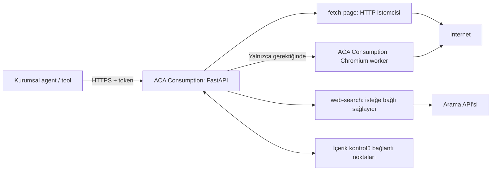

# Agent Gateway

Kurumsal agent'lar için küçük, serverless web gateway. Normal sayfalar HTTP ile, JavaScript gereken sayfalar ayrı Chromium worker ile okunur. Arama bağımsız ve isteğe bağlıdır.



## Başlangıç düzeni

- API: 0.25 vCPU / 0.5 GiB, minimum 0 ve maksimum 2 replica.
- Browser: isteğe bağlı ayrı Container App; 1 vCPU / 2 GiB, minimum 0 ve maksimum 1 replica.
- Worker yalnızca aynı ACA ortamından erişilir ve ayrı token kullanır.
- VM, Squid, NAT Gateway, ayrılmış public IP ve ayrı load balancer kurulmaz.
- HTTPS adresini ACA sağlar. Sabit çıkış IP'si ve IP rotasyonu yoktur.
- İki servis de sıfıra ölçeklenebilir. Ölçek düşmesi anlık değildir; açılış ve soğuma sürelerinde ücret oluşabilir. İlk istekte açılış gecikmesi vardır.

Worker senkron HTTP yanıtı verdiği için ACA Job yerine ayrı Container App kullanılır. Her render için browser/context açılır ve sonunda kapatılır. Worker varsayılan olarak **kurulmaz**; `enable_browser = true` ile açılır. Normal fetch otomatik olarak Chromium'a geçmez.

## Endpoint'ler

| Endpoint | Davranış |
|---|---|
| `GET /healthz` | Uygulama sağlık kontrolü |
| `POST /fetch-page` | HTTP ile HTML/metin/JSON getirir; script ve style çıkarılır |
| `POST /browse-page` | Ayrı worker'da JavaScript çalıştırıp görünen metni getirir |
| `POST /web-search` | Yapılandırılmış arama sağlayıcısını çağırır |

Sayfa endpoint'leri `{"url":"https://example.com"}`; arama `{"query":"Azure","max_results":5}` gövdesini alır. POST endpoint'leri `Authorization: Bearer <token>` ister.

Web içeriği `untrusted_content: true` olarak döner. Bu, bir modelin içeriği güvenli bulduğu anlamına gelmez; içerik agent için güvenilmeyen kaynak verisidir.

## Yerelde çalıştır

Gerekenler: Python 3.12+, uv ve Docker Compose.

```bash
cp .env.example .env
python -c 'import secrets; print(secrets.token_urlsafe(32))'
```

Token'ı `.env` içindeki `GATEWAY_API_TOKEN` alanına yaz. Browser için farklı bir token üretip `GATEWAY_BROWSER_TOKEN` alanına yaz.

Yalnızca API/fetch:

```bash
docker compose up -d --build api
```

Chromium da çalışsın:

```bash
docker compose --profile browser up -d --build
```

```bash
export GATEWAY_API_TOKEN='env-dosyasindaki-token'
curl http://127.0.0.1:8000/fetch-page \
  -H "Authorization: Bearer $GATEWAY_API_TOKEN" \
  -H 'Content-Type: application/json' \
  -d '{"url":"https://example.com"}'
```

JavaScript için aynı isteği `/browse-page` adresine gönder. Swagger: `http://127.0.0.1:8000/docs`.

## Web araması

Başlangıçta kapalıdır. Açmak için `.env` içinde:

```dotenv
GATEWAY_SEARCH_PROVIDER=brave
GATEWAY_SEARCH_API_KEY=your-key
```

`api.search.brave.com` açık domain listesinde olmalıdır. Brave zorunlu değildir; mevcut tek hazır adaptördür. Yeni sağlayıcılar `app/search.py` içine eklenebilir. Playwright ile arama motoru sayfası açmak hazır search adaptörü değildir; CAPTCHA, engeller ve HTML ayrıştırması ayrıca ele alınmalıdır.

Aramanın ayrı dakika limiti vardır; bu, sağlayıcı hesabındaki harcama tavanının yerine geçmez.

## Azure dağıtımı

Gerekenler: Terraform 1.9+, Azure CLI, Docker ve yayınlayabileceğin bir container registry.

### Image'ları yayınla

Registry'ye kendi hesabınla giriş yap. Script varsayılan olarak yalnızca API image'ını build edip pushlar:

```bash
sh scripts/build_images.sh ghcr.io/dcantoka/agent-proxy-gateway 0.2.0
```

Browser da gerekiyorsa:

```bash
sh scripts/build_images.sh ghcr.io/dcantoka/agent-proxy-gateway 0.2.0 --with-browser
```

Terraform örneği **public** GHCR image'ları kullanır. Image'ları yayınlamadan Terraform apply çalışmaz. GHCR package görünürlüğünü public yap; sırları image'a ekleme. Bu repository güncellemesi kendi başına GHCR image yayınlamaz. ACR/özel registry kullanacaksan registry kimlik doğrulaması ayrıca eklenmelidir. Üretimde immutable tag veya digest kullan.

### Terraform

```bash
az login
az provider register --namespace Microsoft.App
cp infra/terraform.tfvars.example infra/terraform.tfvars
```

Abonelik, image ve kurumsal public çıkış CIDR'larını değiştir. `203.0.113.20/32` yalnızca örnektir; `client_cidrs` dışındaki adresler API ingress'inden erişemez.

```bash
export TF_VAR_api_token='en-az-32-karakter-rastgele-token'
terraform -chdir=infra init
terraform -chdir=infra plan -out=deployment.tfplan
terraform -chdir=infra apply deployment.tfplan
terraform -chdir=infra output -raw gateway_url
```

Browser için `enable_browser = true` yap, image adresini yaz ve ayrı token sağla:

```bash
export TF_VAR_browser_token='farkli-en-az-32-karakter-rastgele-token'
```

Aramayı Azure'da açmak için `search_provider = "brave"` ve `TF_VAR_search_api_key` kullan. Terraform API ile worker adresini otomatik bağlar.

Sırları `.tfvars` veya Git'e yazma. **Sensitive değerler Terraform state ve plan dosyalarında saklanabilir.** Bunları koru; ekip kullanımında erişimi kısıtlı Azure Storage backend kullan. Key Vault entegrasyonu bu sürümde yoktur.

Eski VM'li sürüm Azure'a uygulandıysa aynı state ile yeni plan VM, IP ve load balancer kaynaklarını silmeyi önerebilir. Yeni düzeni ayrı isim ve ayrı state ile kurup doğruladıktan sonra eskisini kaldır. Otomatik/kesintisiz migration yoktur.

## Maliyet ve limitler

- API ve browser bağımsız ölçeklenir. Browser'ı yalnızca gerektiğinde çağır.
- `api_max_replicas` API sınırını belirler; worker maksimum 1'dir.
- Fetch/arama cache'i süreç belleğinde 60 saniye ve en fazla 32 kayıttır. Fetch `no-store`, `no-cache`, `private` yanıtlarını saklamaz. Kapatmak için `GATEWAY_CACHE_TTL_SECONDS=0`; Terraform'da `cache_ttl_seconds = 0`.
- Cache restart ve scale-to-zero sonrasında kaybolur. Eşzamanlı aynı istekler birleştirilmez.
- Rate limit ve cache replica başınadır. Kesin ortak kota için sonradan paylaşımlı store gerekir.
- Normal fetch sınırı 2 MB/30 saniyedir. Browser render sınırı 45 saniye; en fazla 50 kaynak ve toplam 10 MB indirme. API worker açılışı için 150 saniyeye kadar bekler.
- Chromium görüntü, video, font, WebSocket, service worker, POST ve login oturumlarını desteklemez. Script/API/CDN domain'leri de açık listede olmalıdır.
- Scale-to-zero faturanın kesin sıfır olması değildir. Başlangıç/soğuma süresi, trafik, arama, registry ve sonradan açılan log saklama ayrı giderdir.

Terraform Log Analytics workspace veya ücretli registry oluşturmaz. Environment log hedefi Azure Monitor'dür; kalıcı merkezi saklama için diagnostic settings ayrıca yapılandırılmalıdır. Uygulama stdout logları ACA log stream üzerinden izlenebilir.

## Erişim ve içerik kontrolleri

Açık liste tam domain eşleşmesi kullanır. `example.com`, `api.example.com` için izin vermez. Fetch redirect'leri ve browser alt kaynakları kontrol edilir. Private/rezerve IP ve Azure metadata hedefleri reddedilir; bağlantı doğrulanan IP'ye sabitlenir, HTTP Host ve HTTPS SNI korunur.

Browser sayfasının HTTP istekleri de doğrulanan HTTP istemcisiyle karşılanır. Bunlar ele geçirilmiş bir container'a karşı ağ seviyesinde izolasyon değildir. Kurumsal agent'ın gateway dışındaki internet erişimini kapatmak kurum ağında ayrıca yapılmalıdır.

`app/policy.py` içindeki `inspect_input` ve `inspect_output` boş bağlantı noktalarıdır; Content Safety, DLP ve prompt injection modeli henüz bağlı değildir. Entra ID ve tenant yönetimi yoktur.

## Kontroller

```bash
uv sync --frozen --extra browser
uv run pytest -q
uv run ruff check .
terraform -chdir=infra init -backend=false
terraform -chdir=infra validate
terraform -chdir=infra test
```

Chromium integration testleri sistemde `chromium` varsa çalışır. Terraform testleri mock provider kullanır; Azure kaynağı oluşturmaz.

`session_id` ve yanıttaki `proxy` alanı kaldırıldı. Sayfa yanıtları `url`, `text`, `content_type`, `cache_hit`, `untrusted_content` döndürür. IP havuzu gerektiğinde `WebClient.resource` katmanına eklenebilir.
