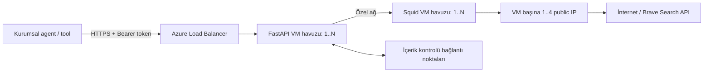

# Agent Gateway

Kurumsal agent'ların web araması ve sayfa okuma isteklerini Azure üzerinden yöneten küçük bir FastAPI projesi. ProxyForge kodunu değiştirmez; FastAPI ve Azure için ayrı bir başlangıç uygulamasıdır.



Başlangıç: **1 API VM + 1 proxy VM**. Terraform ile iki grubun sayısı ayrı artırılır. API adresi load balancer sayesinde sabit kalır.

## Neler var?

- `POST /fetch-page`: HTML, metin veya JSON getirir. HTML içinden script/style çıkarır.
- `POST /web-search`: Brave Search API üzerinden arama yapar. Kendi API anahtarın gerekir.
- Bearer token, açık domain listesi, özel/rezerve IP engeli, redirect kontrolü.
- Yanıt boyutu, zaman aşımı, eşzamanlılık ve dakikalık istek sınırı.
- Round robin çıkış seçimi ve isteğe bağlı `session_id` ile aynı çıkışı koruma.
- Sorgu içeriği ve sırları kaydetmeyen JSON erişim logları.
- HTTPS, Docker, Terraform ve SSH üzerinden dağıtım betiği.

`app/policy.py` içindeki `inspect_input` ve `inspect_output` şu an boş bağlantı noktalarıdır. Content Safety, DLP veya prompt injection modeli **henüz bağlı değildir**. `untrusted_content: true`, dönen içeriğin agent tarafından talimat olarak kabul edilmemesi gerektiğini belirtir; bir güvenlik taraması sonucu değildir.

## Yerelde çalıştır

Gerekenler: Python 3.12+, [uv](https://docs.astral.sh/uv/), Docker Compose.

```bash
cp .env.example .env
python -c 'import secrets; print(secrets.token_urlsafe(32))'
```

Ürettiğin token'ı `.env` dosyasındaki `GATEWAY_API_TOKEN` değerine yaz. Arama için `GATEWAY_SEARCH_API_KEY` ekle.

```bash
docker compose up -d --build
```

API yalnızca `127.0.0.1:8000` üzerinde açılır. Swagger: `http://127.0.0.1:8000/docs`.

```bash
export GATEWAY_API_TOKEN='env-dosyasina-yazdigin-token'

curl http://127.0.0.1:8000/fetch-page \
  -H "Authorization: Bearer $GATEWAY_API_TOKEN" \
  -H 'Content-Type: application/json' \
  -d '{"url":"https://example.com","session_id":"agent-1"}'

curl http://127.0.0.1:8000/web-search \
  -H "Authorization: Bearer $GATEWAY_API_TOKEN" \
  -H 'Content-Type: application/json' \
  -d '{"query":"Azure FastAPI","max_results":5}'
```

Yerel açık domain listesini değiştirirken hem `.env` içindeki `GATEWAY_ALLOWED_DOMAINS` hem `deploy/squid.local.conf` içindeki `allowed_domains` satırını güncelle. Tam domain eşleşmesi kullanılır; `example.com` izni alt domain'leri kapsamaz. `docker compose up -d --force-recreate` ile yeniden yükle.

## Azure altyapısını kur

Gerekenler: Terraform 1.9+, Azure CLI, SSH anahtarı ve Azure aboneliği. Bu adımlar ücretli Azure kaynakları oluşturur.

```bash
az login
cp infra/terraform.tfvars.example infra/terraform.tfvars
```

`terraform.tfvars` içindeki abonelik, SSH public key ve CIDR değerlerini değiştir. `client_cidrs`, kurumsal ağın Azure'a çıkarken kullandığı public IP aralıklarıdır. `admin_cidrs`, SSH bağlantısını yapacağın ağın public IP aralıklarıdır. Örnek IP'ler dokümantasyon içindir; gerçek erişim sağlamaz.

```bash
terraform -chdir=infra init
terraform -chdir=infra plan -out=deployment.tfplan
terraform -chdir=infra apply deployment.tfplan
mkdir -p work
terraform -chdir=infra output -json deployment > work/inventory.json
terraform -chdir=infra output -raw gateway_ip
```

Domain'inin A kaydını `gateway_ip` adresine yönlendir. O domain için kurum CA'ndan veya bir sertifika sağlayıcısından PEM sertifikası ve anahtarı al. `cert.pem`, gerekiyorsa ara sertifikalarla birlikte full chain olmalı. TLS yenilemesi otomatik değildir; sertifika yenilendiğinde yeniden dağıt.

Terraform state ve plan dosyalarını Git'e ekleme. Ekip kullanımında state'i erişimi kısıtlı Azure Storage backend'ine taşı. API token'ı, arama anahtarı ve TLS private key Terraform değişkenlerine veya cloud-init'e yazılmaz.

## Uygulamayı dağıt

VM'lerde cloud-init Docker kurar. Uygulama dağıtımı ayrı betikle yapılır.

İlk bağlantıda envanterdeki her VM'ye `ssh azureuser@VM_PUBLIC_IP` ile bağlan; SSH fingerprint'ini güvenilir Azure yönetim kanalından doğrulayıp known_hosts'a ekle. Betik host key kontrolünü kapatmaz. VM'ye varsayılan SSH anahtarın veya `--identity` ile verdiğin anahtarla erişilebilmeli.

```bash
export GATEWAY_API_TOKEN="$(python -c 'import secrets; print(secrets.token_urlsafe(32))')"
export GATEWAY_SEARCH_API_KEY='brave-api-anahtarin'

python scripts/deploy.py \
  --inventory work/inventory.json \
  --tls-cert /path/to/cert.pem \
  --tls-key /path/to/key.pem \
  --allowed-domain example.com \
  --allowed-domain api.search.brave.com
```

Bu komut yalnızca `work/deploy/` altında paketleri hazırlar. Aynı komuta `--apply` eklemek SSH ile dağıtır. Gerekirse `--identity /path/to/ssh_key` ekle. Token'ı güvenli bir yerde sakla ve sonraki dağıtımlarda aynı değeri kullan; her çalıştırmada yeni token üretmek istemcileri etkiler.

Paketlerde token ve TLS anahtarı bulunur. `work/` Git tarafından dışlanır ve paketler yalnızca sahibinin okuyabileceği izinlerle oluşturulur. Paylaşma; dağıtım sonrasında yerel paketleri silebilirsin. VM'deki uygulama dosyaları `/opt/agent-gateway` altındadır ve root tarafından okunur.

```bash
curl https://agent-gateway.sirket.com/healthz
```

Kurum CA'sı kullanıyorsan istemcinin bu CA'ya güvenmesi gerekir. TLS doğrulamasını kapatma.

## Sayıyı ve IP havuzunu artır

`infra/terraform.tfvars`:

```hcl
api_vm_count     = 1
proxy_vm_count   = 2
proxy_ips_per_vm = 2
```

Bu örnek **1 API VM, 2 Squid VM ve toplam 4 proxy çıkış IP'si** oluşturur. API VM'lerinin yönetim IP'leri ve load balancer IP'si bu sayıya dahil değildir.

1. Terraform plan'ını incele ve uygula.
2. `terraform output -json deployment` ile envanteri yenile.
3. Yeni VM'lerin SSH host key'lerini doğrula.
4. Dağıtım betiğini aynı sırlar, sertifika ve domain listesiyle tekrar çalıştır.

Betik önce Squid'leri, ardından API'leri günceller. Proxy listesi tüm API'lere yeniden dağıtılır; servis keşfi veya otomatik autoscale yoktur. İşlemler rolling/zero-downtime garantisi vermez. Özellikle küçültme ve IP sayısı değişimlerini bakım aralığında yap; Terraform silme veya VM yenileme planlayabilir.

### IP seçimi

Her public IP, VM üzerindeki ayrı private IP'ye Azure tarafından eşlenir. Squid'in `3128`, `3129`, `3130`, `3131` portları bu adreslere ayrı bağlanır. Ek private IP'ler işletim sistemine de eklenir ve systemd ile yeniden açılışta korunur.

- `session_id` yoksa istekler yapılandırılmış çıkışlar arasında sırayla gider.
- Aynı `session_id`, havuz değişmediği sürece aynı çıkışı seçer.
- Bir proxy ve bir public IP varsa gerçek rotasyon olmaz. İki IP veya ikinci proxy eklemelisin.
- Proxy hatasında doğrudan internete çıkılmaz. Otomatik sağlık bazlı failover yoktur.
- Hedef `429` döndürürse `Retry-After` istemciye aktarılır; başka IP ile otomatik tekrar denenmez.
- Brave kotası API anahtarına da bağlıdır; IP değiştirmek sağlayıcı kotasını artırmaz.

## Ağ sınırları

- API HTTPS erişimi yalnızca `client_cidrs` üzerinden kabul edilir.
- SSH yalnızca `admin_cidrs` üzerinden kabul edilir.
- Squid portları yalnızca API subnet'inden erişilebilir; internete açık proxy oluşturulmaz.
- API'nin `8080` portu yalnızca Azure load balancer sağlık kontrolüne açıktır.
- API ve Squid aynı açık domain listesini kullanır. Redirect hedefleri tekrar kontrol edilir; Squid bağlantı anında private/rezerve hedefleri de reddeder.
- Bu sürüm IPv4 proxy çıkışı kullanır; IPv6 hedef erişimi Squid tarafında kapalıdır.

VM'lerin güncelleme ve Docker image indirme için doğrudan outbound erişimi vardır. Uygulamanın web araçları zorunlu olarak Squid kullanır; bu kurulum, VM ele geçirilmesine karşı ağ seviyesinde tam outbound izolasyonu sağlamaz. Kurumsal agent ortamının gateway dışındaki internet erişimini kapatmak da kurum ağında ayrıca yapılmalıdır.

## Bilerek küçük tutulan kapsam

- Tek ortak token; kullanıcı/tenant yönetimi ve Entra ID entegrasyonu yok.
- Rate limit, round robin ve eşzamanlılık sınırı API süreci başınadır. İki API VM'de toplam kota yaklaşık iki katına çıkar. Ortak limit gerekirse Redis ekle.
- Veritabanı ve cache yok; ayarlar ortam değişkenlerinden, loglar stdout'tan gelir.
- `/healthz` yalnızca API'nin ayakta olduğunu gösterir; internet veya proxy sağlık testi değildir.
- HTTP/HTTPS metin erişimi var; browser automation, dosya indirme, VPN ve TLS inspection yok.
- VM patch yönetimi, merkezi log saklama, sertifika yenileme ve model entegrasyonları sonraki adımlardır.

## Kontroller

```bash
uv sync --frozen
uv run pytest -q
uv run ruff check .
terraform -chdir=infra fmt -check -recursive
terraform -chdir=infra init -backend=false
terraform -chdir=infra validate
terraform -chdir=infra test
```

Terraform testleri mock provider kullanır; Azure kaynağı oluşturmaz. Gerçek Azure dağıtımından sonra her çıkışın public IP'sini, kurumun izin verdiği bir IP gösterim servisi üzerinden doğrula.
